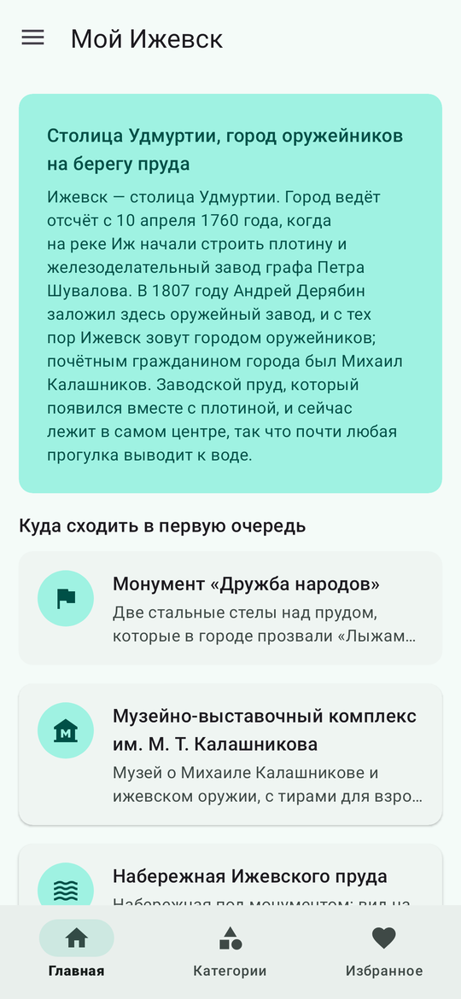
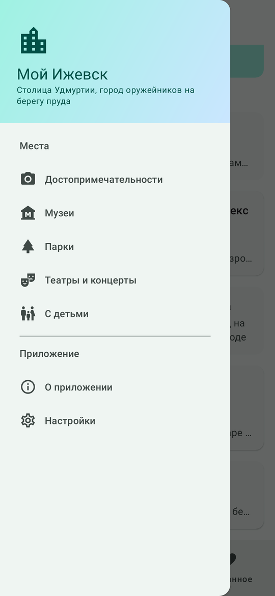
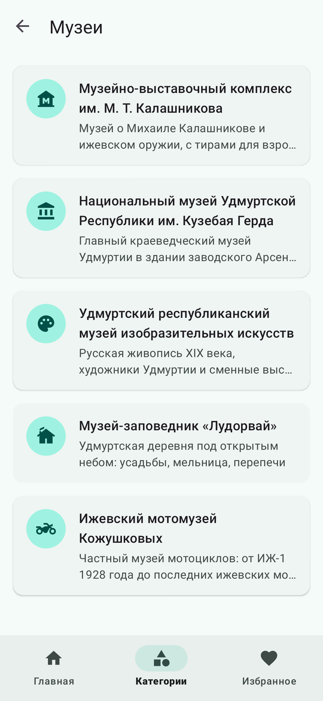
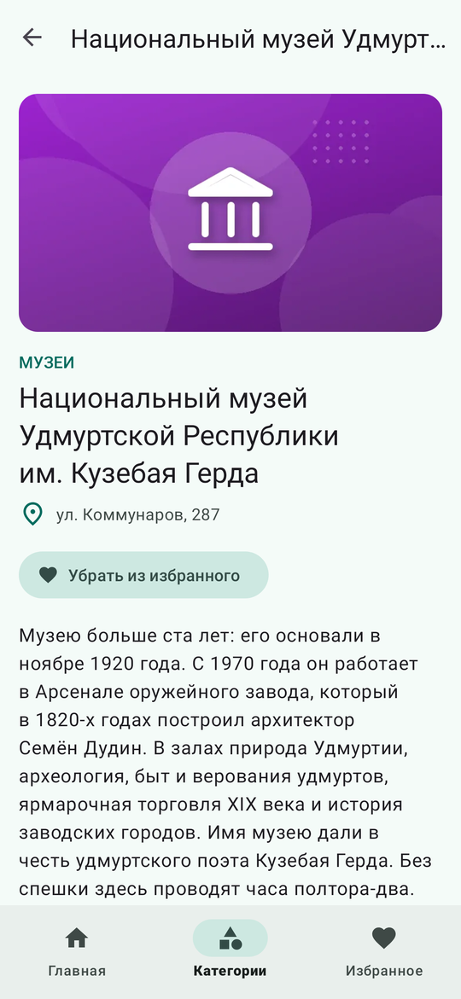
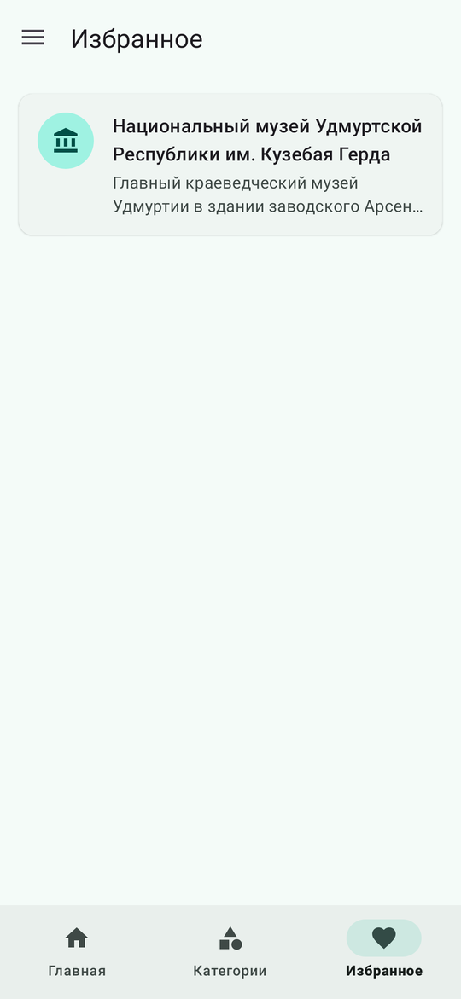
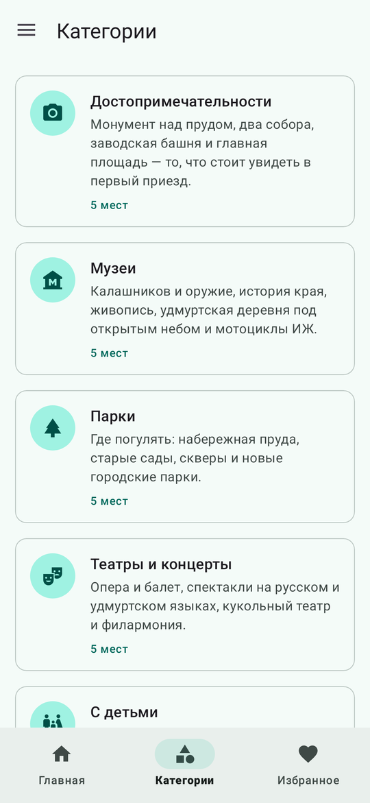
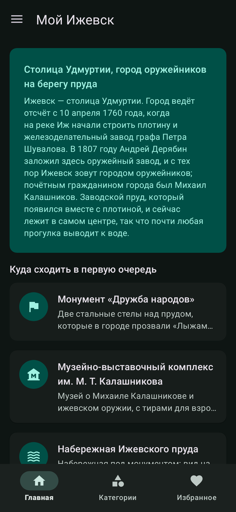
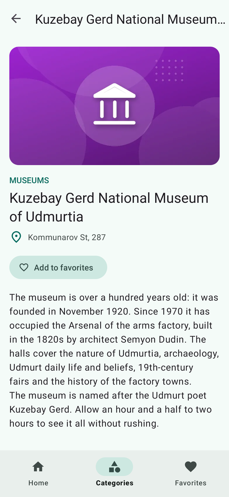
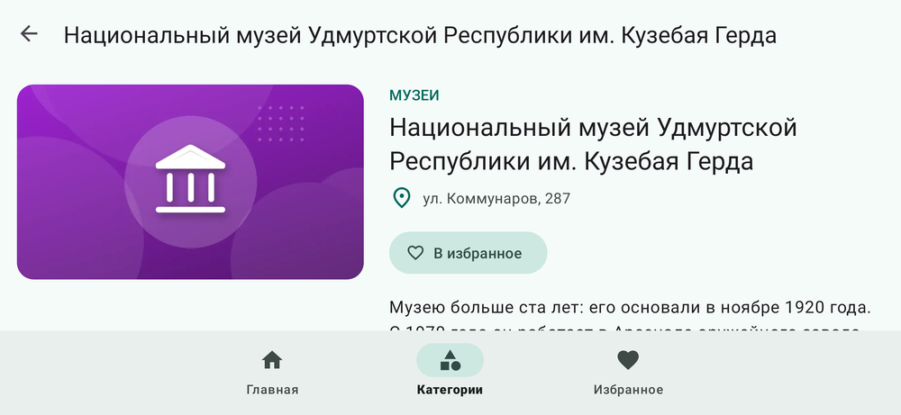
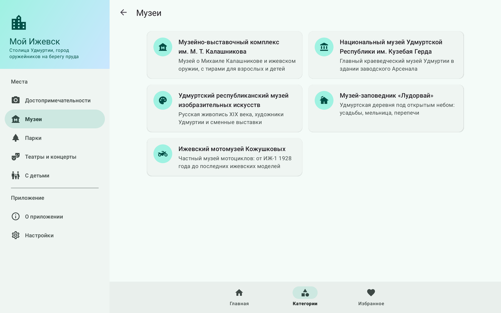

# Мой Ижевск

Лабораторная работа № 4 «Город»: приложение подсказывает, что посмотреть в Ижевске, — достопримечательности, музеи, парки, театры и места, куда можно пойти с детьми. Разметка на XML, навигация на Jetpack Navigation: один граф `nav_graph.xml`, аргументы через Safe Args.

## Что умеет

- Главный экран: коротко о городе и по одному месту из каждой категории.
- Боковая панель (`DrawerLayout` + `NavigationView`) открывается кнопкой меню в Toolbar. В ней пять категорий, «О приложении» и «Настройки», пункт текущего экрана выделен.
- Нижняя панель (`BottomNavigationView`): главная, категории, избранное. Связана с `NavController` через `setupWithNavController`, вкладка всегда открывается со своего первого экрана.
- Места категории — список на `RecyclerView`: название, значок и краткое описание. По нажатию открывается экран места с картинкой, адресом и подробным рассказом.
- Кнопка «В избранное» на экране места. Избранное хранится в `SharedPreferences` и собрано на отдельной вкладке.
- В настройках выбирается тема: как в системе, светлая или тёмная.
- Интерфейс и тексты мест на русском и английском (`values`, `values-en`, `values-ru`).
- Поворот экрана не сбрасывает открытый экран, выбранную вкладку и открытую боковую панель.
- В альбомной ориентации карточки идут в две колонки, а на экране места картинка стоит слева от текста (`layout-land`). На планшете (`layout-w840dp-h480dp`) боковая панель постоянная, кнопка меню не нужна.

## Как устроено

| Часть | Что внутри |
|---|---|
| `data` | модели `Category`, `Place`, `CategoryId`, `ThemeMode`; `PlacesDataSource` (тексты в `strings.xml`, здесь только идентификаторы ресурсов); `PlacesRepository`, `FavoritesRepository`, `SettingsRepository` |
| `ui` | `CityViewModel` — одна на все экраны (`activityViewModels`), создаётся через `CityViewModelFactory`; фрагменты главной, категорий, мест категории, экрана места, избранного, «О приложении» и настроек; `ListAdapter` и `ViewHolder` списков |
| `MainActivity` | только навигация: Toolbar, нижняя и боковая панели, отступы под системные панели |

`categoryId` (enum) и `placeId` передаются аргументами Safe Args, заголовок экрана берётся из аргумента (`{categoryTitle}`, `{placeName}`). Категория из боковой панели открывается внутри вкладки «Категории», поэтому «Назад» возвращает к списку категорий.

Картинки мест нарисованы для этого приложения: градиент цвета категории и значок из набора Material Symbols (лицензия Apache 2.0). Формат WebP 720 × 405, лежат в `res/drawable-nodpi`, все вместе около 200 КБ. Адреса и даты сверены с сайтами самих мест и городским порталом, цены и часы работы не указаны.

## Запуск

Открыть папку проекта в Android Studio и запустить конфигурацию `app` (minSdk 24, targetSdk 36). Локальные тесты репозиториев и ViewModel: `gradlew testDebugUnitTest`.

## Экраны

| Главная | Боковая панель | Музеи | Экран места |
|---|---|---|---|
|  |  |  |  |

| Избранное | Категории | Тёмная тема | English |
|---|---|---|---|
|  |  |  |  |

Альбомная ориентация:

Планшет, постоянная боковая панель:

